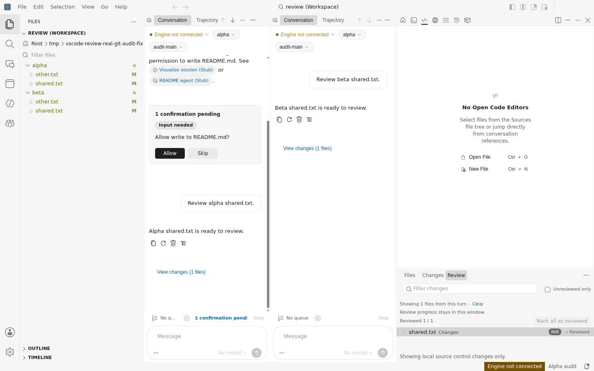
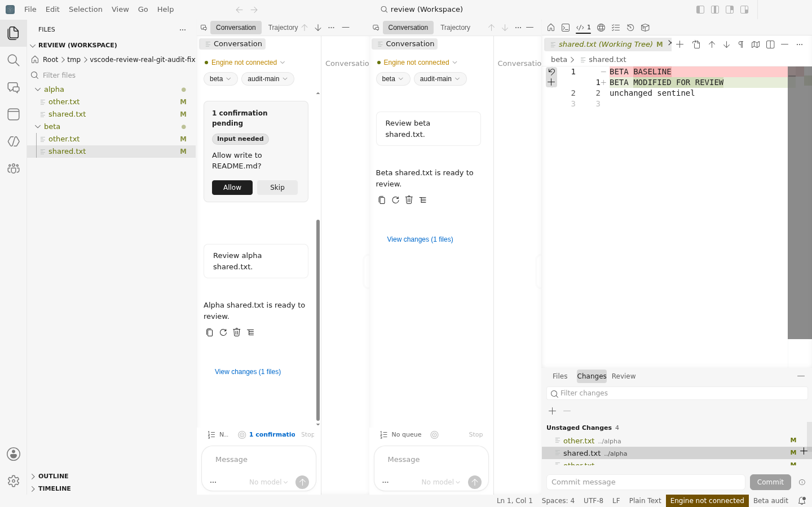
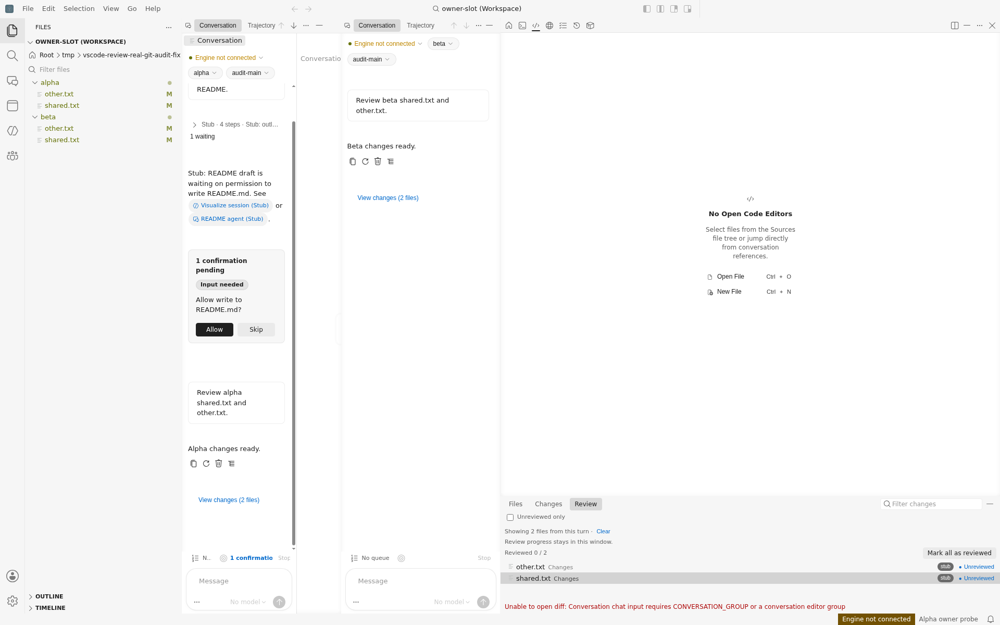
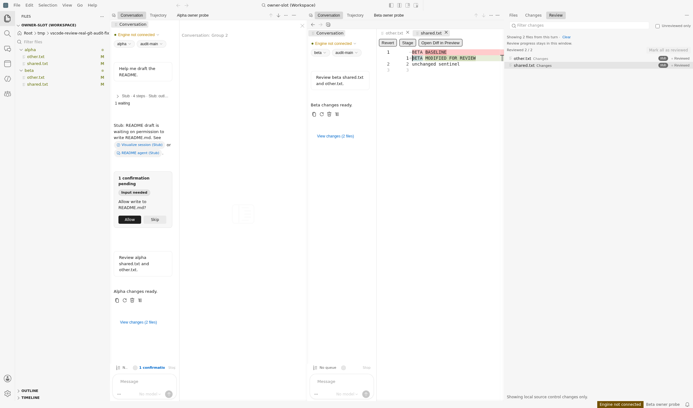
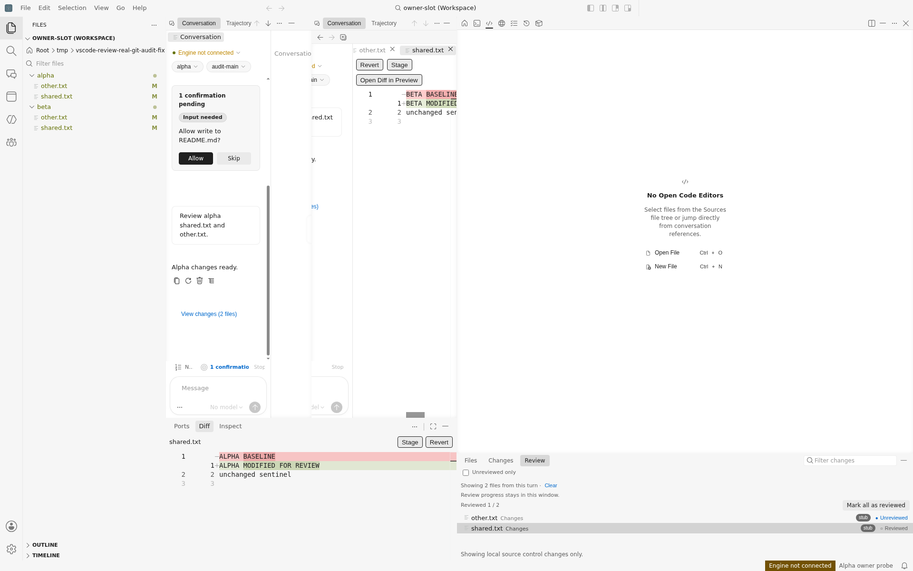

# D1387 before 与设计来源

这是修复前取证，不是实现后的验证。正式方案见 [Sources 打开分派与准确 Conversation 目标](../../plans/sources-open-dispatch-and-conversation-target.md)；[Astra 两轮裁定原文](d1387-astra-design-decision.md)已入库，正式稿仍须规则16。D1387 open，不升 PRD，不倒灌已闭 D1382/D1386。

## 已执行事实

独立空 profile、Xvfb，默认编辑器从唯一 merge/out 启动；本地 Stub roster 与通知夹具，真实内置 Git provider。自己的 `/tmp/vscode-review-real-git-audit-fixture/alpha` / `beta` 各 baseline commit + shared/other 未暂存修改，同名文件两侧分别有 ALPHA/BETA 哨兵。断连、零 Git RPC；[fixture 前后](d1387-fixture-before-after.json) HEAD/index/worktree 完全相同。无用户仓库/设备/登录/在线引擎，自己的进程/profile 已[清理](d1387-owner-slot-cleanup.json)。

1. Preview 正常 Review 鼠标/Enter 不开 diff，却标 Reviewed；先有 Beta 再从 Changes 打开 Alpha，Alpha resource.open 实际被调、旧 Beta 留在界面。[实际资源DTO](d1387-preview-resource-before.json) / [Changes实际调用与旧diff](d1387-preview-changes-before.json)。同一资源 DTO 的直接执行能开相应两侧，只用作诊断正对照，不算产品入口通过。
2. Conversation C1 Alpha 首次 replace、C2 Beta list 真 Enter/newTab 均创建准确空 side group 后拒绝，Review 不增长。C3 公共无 slot `sources.review.openSelected` 在 Beta group10 真开两侧、只读、root8 保留、0/2→1/2。
3. C4 已有 diff 后 replace 未开 other 实际成功；newTab/同条 reveal 再失败。C5 先 focus Alpha 再选 Beta，公共无 slot仍落准确 Beta 组。C6 Panel真开 Alpha，Preview负对照仍复现。详见[完整机器观察](d1387-owner-slot-before.json)与[宽窗口公共对照](d1387-owner-slot-wide-control.json)。
4. [Debugger trace](d1387-owner-slot-trace.json)直接读取 call frame：Alpha preferred9 属 untitled[7,9]、Beta preferred10 属 session-102[8,10]；explicit=false，excluded 检查把 group9/10 改为 main0。空组/newTab/reveal 的实际 slot plan=open；replace另一条 plan=replace 并绕过该 finder。没有替换生产函数、resource.open 或私有 Sources 状态。
5. [五实际模块源/加载摘要](d1387-owner-slot-source-manifest.json)来自 renderer Debugger 副本，inline source map sourcesContent 的五 TS SHA 等于 J4fb 与采样时 merge1247 的源；模块为 Sources helper、slot helper、finder、EditorService、Conversation fence。原 Preview [源摘要](d1387-preview-source-manifest.json)保留。不是全 out 同构建，也不是新 D1387 after。

两条独立机制：SCM 内置 API open/diff 漏分派；允许的 typed input 与准确 concrete Conversation 组未被 finder 作为显式目标承认。Astra 最终选择就近 Sources dispatch 与 finder有效成员判定，不复制 slot、不改 extHost map、不重新选活动叶；详见设计原文与正式方案。

## 截图

## 限制与下一门槛

命令 void 不等于失败或可见 pane；成功证据是实际两侧文本、控件/输入/会话与截图。没有证明任意自定义 provider 的内部取消/外部打开结果；没有真实 engine 行或写入。数字组id、伪造/过期对象、其他excluded part、普通输入围栏负控、move往返与迟到命令尚未运行。由正式 red/green 与非作者新产物 after 覆盖；旧before不能替代。

本段留存只读审计事实与设计来源。作者转实施前只ff到d472已验证基线；本检查点未改生产、未编译/transpile/typecheck/写out/跑依赖out测试，不把父的其他主题验证计到本刀。
